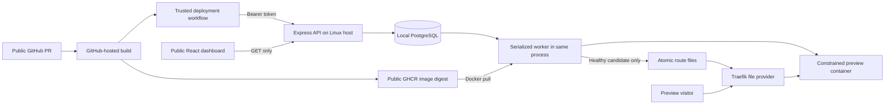

# Preview Platform

Local MVP: **Express + TypeScript**, **PostgreSQL**, **React + Vite**, **Docker**,
and **Traefik**. Public read-only dashboard; bearer-protected deploy/delete API.

This is an image deployment service. It does not checkout source or build images.
GitHub Actions does that upstream. The platform pulls an approved public GHCR
digest, health-checks a constrained container, publishes a route and returns status.

**Status:** local deployment flow tested against real PostgreSQL, GHCR, Docker
and Traefik. Not production-ready or deployed to EC2. Production PostgreSQL is
explicitly deferred. See [verification](VERIFICATION.md) and
[implementation plan](IMPLEMENTATION_PLAN.md).

## Architecture



The API process holds Docker authority. The module boundary is **not** a security
isolation boundary. Traefik/dashboard have no Docker socket access. Local HTTP is
for local development only; do not send bearer tokens over public plaintext HTTP.

## Prerequisites

- Native Linux Docker host (local machine now, EC2 later), Docker CLI and Compose.
- Node.js 22+ and npm. Docker bridge IPs must be reachable from the API host.
- No Docker Desktop/remote-Docker adapter is implemented.
- Ports 55432 (PostgreSQL), 18080 (proxy), 18081 (API) available.

## Install and start locally

Run from this project directory:

```sh
npm ci
npm run build
docker compose -f infra/docker-compose.yml up -d --build --wait
```

Create an untracked `.env` using `.env.example` as reference. Set:

- `DEPLOYMENT_TOKEN`: high-entropy random value, not the example placeholder.
- `ALLOWED_IMAGE_NAMESPACE`: lowercase `owner/repository` of your approved image.
- `ROUTES_DIR`: absolute path to this project's `infra/routes` directory.
- `PREVIEW_BASE_URL`: public proxy origin/IP, default `http://13.63.54.222`.
- `PREVIEW_TRAILING_SLASH`: append `/` to generated preview URLs, default `true`.
- Other local values are already listed in `.env.example`.

Generate a token locally with a password manager, or `openssl rand -hex 32`.
Do not paste it into chat, commit it, put it in a URL, or put it in frontend config.

```sh
node --env-file=.env apps/api/dist/index.js
```

Open **http://127.0.0.1:18080/**. The API listens on port 18081;
Traefik keeps dashboard `/`, API `/api/*` and `/healthz`, and preview `/pr-<number>/`
routes separate. Restrict host firewall access
to your development machine/bridge. The PostgreSQL and Traefik published ports
are loopback-only. Compose is not an internet deployment configuration.

For frontend hot reload in another terminal:

```sh
npm run dev:dashboard
```

Vite serves **http://localhost:5173** and proxies API reads to `127.0.0.1:18081`.
No deployment token or action is present in the dashboard.

Stop the foreground API with Ctrl+C. Stop only this project's containers with:

```sh
docker compose -f infra/docker-compose.yml down
```

Do not add `--volumes` unless intentionally discarding local database history.
Compose down does not delete dynamically-created preview containers; use the API
to delete previews while the API/database are running. Worker reconciliation
handles interrupted cleanup when restarted.

## API

| Method/path | Access | Result |
|---|---|---|
| `GET /healthz` | Public | Database/worker health; 503 when degraded |
| `GET /api/previews` | Public | Active previews and serving metadata |
| `GET /api/previews/:id` | Public | Single preview, 404 if absent/deleted |
| `GET /api/deployments/:id` | Public | Attempt status and sanitized failure |
| `POST /api/deployments` | Bearer | 202 with persisted deployment ID |
| `DELETE /api/previews/:id` | Bearer | Persist delete intent, finish serialized cleanup |

Example request body (substitute real approved values):

```json
{
  "repository": "owner/frontend",
  "pullRequestNumber": 42,
  "commitSha": "aaaaaaaaaaaaaaaaaaaaaaaaaaaaaaaaaaaaaaaa",
  "image": "ghcr.io/owner/frontend@sha256:<64 lowercase hexadecimal characters>",
  "containerPort": 3000,
  "ttlHours": 24
}
```

Send `Authorization: Bearer <token>` and `Content-Type: application/json`.
Poll deployment status until `healthy` or `failed`. `previewUrl` exists while
queued but is not promised ready until health succeeds. Repeat of the current
identical request reuses its deployment ID. DELETE is retryable; absent preview
returns 404. During a pull, DELETE may wait for bounded worker work to unwind.

URLs use the single approved repository's PR path, for example
`http://13.63.54.222/pr-42/`. Container names use deployment UUIDs, so old and
candidate containers can coexist until promotion.

Public metadata is deliberately public: repository, commit, image digest, URL,
status, timestamps and fixed error messages. Do not use this configuration for
confidential repository/deployment metadata.

## Image contract and lifecycle

- Public GHCR image in configured repository namespace, **digest required**.
- One self-contained frontend; bind `0.0.0.0` at requested port.
- Return HTTP 2xx on `HEALTH_CHECK_PATH` (default `/healthz`).
- Must work read-only with all Linux capabilities dropped and no new privileges.
- No image-declared `VOLUME`, host mounts, caller commands, env injection or
  privileged/network options. No application Node/curl dependency for health.
- Container limits: 256 MiB RAM (no extra swap), 0.5 CPU, 128 PIDs; bounded logs.
- Five active previews by default, with at most one extra replacement candidate
  during an individual PR replacement.
- One-day TTL by default, capped at seven days. Local reconciliation every minute.
- Failed replacement preserves serving image/commit/URL; failed attempt details
  remain available at deployment endpoint. Missing/stopped containers become
  unhealthy without blocking other previews. Explicit redeployment repairs them.
- Cleanup removes owned containers/routes and eligible unused image digests.
  Shared/tagged images and images used by unrelated containers are retained.

## Verification commands

```sh
npm test                          # Unit/API/UI tests; real-Docker cases skipped
RUN_DOCKER_TESTS=1 npm test        # Includes disposable PostgreSQL and Docker tests
npm run typecheck
npm run lint                     # Currently TypeScript validation, not ESLint
npm run build
npm audit
npm run e2e:local                 # Complete local GHCR-to-HTTP lifecycle
```

E2E downloads a digest-pinned public `stefanprodan/podinfo` fixture. It starts
UUID-named disposable PostgreSQL/Traefik/network resources, tests real API calls,
route health, replacement, failure, worker restart, deletion and expiry, then
removes only its own resources. No EC2 or existing database access occurs.
Requires internet for image pulls and native Docker networking. Base-image cache
can remain after tests; no global Docker prune is performed.

## GitHub workflows

See [.github/workflows/README.md](.github/workflows/README.md) for setup/security.
The supplied fixture workflow builds Dockerfile target `preview` on port 80.
It previews this repository's static dashboard bundle as an example frontend;
it does not provision another platform API/database inside each preview.
Your separate frontend repository needs its own Dockerfile and corresponding
target/health/port configuration. Default supplied build architecture is amd64;
confirm the existing EC2 architecture before adopting it.

Store `PREVIEW_PLATFORM_TOKEN` in a GitHub **environment** restricted to trusted
default-branch deployments, never in the untrusted PR build job. Set repository
variable `PREVIEW_PLATFORM_API_URL` to a real HTTPS endpoint. Both workflows must
exist on default branch. New GHCR packages can default to private even for public
repositories; explicitly set package visibility to Public before deployment.

## Release gates and known limits

1. **Production database deferred:** the backend requires PostgreSQL. It does not
   expose your local database to EC2 or silently replace persistence with memory.
2. **EC2 not configured:** need host OS/architecture/capacity, safe access, available
   ports and process supervision. Never expose Docker remote API.
3. **TLS/DNS not provisioned:** need actual DNS/IP reachability and certificate
   setup. `PREVIEW_BASE_URL=https://...` changes URLs, not certificates or Traefik TLS.
4. **Workflow execution not proven:** static YAML validation is not a live GitHub
   build/push/deploy/close test.
5. **No hard image-pull disk quota or network egress isolation:** read-only root,
   count limits and GC do not prevent a huge approved image filling host disk or
   an approved container contacting host/cloud metadata services. Apply host-level
   disk monitoring and egress/metadata restrictions before internet deployment.
6. **Not hostile multi-tenant isolation:** trusted repository only. Docker limits
   are not a replacement for a sandbox. API/worker share Docker authority.
7. **Health semantics:** health means successful promotion probe plus runtime
   running-state observation, not continuous HTTP uptime monitoring.
8. **Route switch not atomic with DB:** restart restores committed state; Traefik
   reload can briefly lag. No zero-downtime claim or rollback after host data loss.
9. **No load/security certification:** tested bounded behavior and recovery paths,
   not exhaustive fuzzing, penetration testing or measured EC2 throughput.

The detailed acceptance evidence is in [VERIFICATION.md](VERIFICATION.md).
